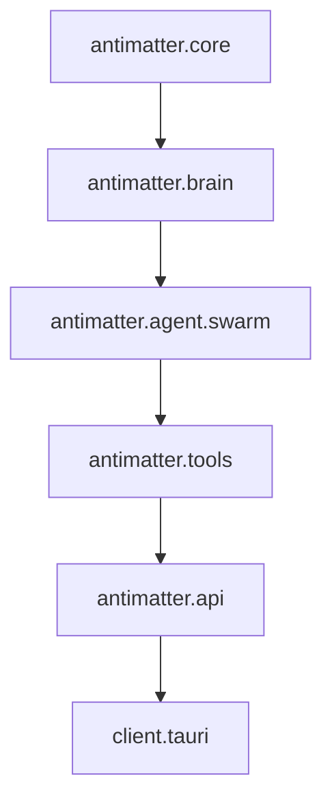

# Project Antimatter — Living Technical Wiki

> ⚡ Autogenerated from live codebase AST analysis.

## Architecture Overview

## Module Index

| Module Path | Primary Classes | Primary Functions | Description |
|---|---|---|---|
| `C:/Users/para-/Documents/antigravity/Antimatter/antimatter/__init__.py` | — | — | Project Antimatter: Sovereign Offline Agentic IDE Runtime. |
| `C:/Users/para-/Documents/antigravity/Antimatter/antimatter/agent/__init__.py` | — | — | Autonomous Multi-Agent Orchestrator and Antigravity Runtime for Project Antimatt |
| `C:/Users/para-/Documents/antigravity/Antimatter/antimatter/agent/blunder_harvester.py` | `HarvestedBlunder`, `TranscriptBlunderHarvester` | — | Transcript Blunder Harvester inspired by Project Chimera's harvest_chat_blunders |
| `C:/Users/para-/Documents/antigravity/Antimatter/antimatter/agent/compactor.py` | `ContextCompactor` | — | Context Window Compactor for Project Antimatter. |
| `C:/Users/para-/Documents/antigravity/Antimatter/antimatter/agent/event_bus.py` | `AgentMessage`, `SharedBlackboard`, `AgentEventBus` | — | Multi-Agent Event Bus & Shared Blackboard for Project Antimatter. |
| `C:/Users/para-/Documents/antigravity/Antimatter/antimatter/agent/loop.py` | `AgentReActLoop` | — | Autonomous ReAct Agent Loop for Project Antimatter. |
| `C:/Users/para-/Documents/antigravity/Antimatter/antimatter/agent/relay.py` | `SpecialistDomain`, `RelayBaton`, `RelayConsultationResult` | — | Orchestrated Specialist Relay Engine for Project Antimatter. |
| `C:/Users/para-/Documents/antigravity/Antimatter/antimatter/agent/skills/loader.py` | `Skill`, `SkillLoader` | — | Dynamic SKILL.md Parser and Customization Loader for Project Antimatter. |
| `C:/Users/para-/Documents/antigravity/Antimatter/antimatter/agent/skills/mcp_bridge.py` | `MCPClient` | — | Model Context Protocol (MCP) Stdio Client Bridge for Project Antimatter. |
| `C:/Users/para-/Documents/antigravity/Antimatter/antimatter/agent/specialists/__init__.py` | — | — | Domain-specific local AI specialists for Project Antimatter. |
| `C:/Users/para-/Documents/antigravity/Antimatter/antimatter/agent/specialists/critic.py` | `CriticVerdict`, `CodeIssue`, `CodeCritiqueReport` | — | Deep Reasoning & Code Critic Specialist for Project Antimatter. |
| `C:/Users/para-/Documents/antigravity/Antimatter/antimatter/agent/specialists/fuzzer.py` | `FuzzingSessionReport`, `GameQAFuzzer` | — | Autonomous Multi-Agent Game QA & Fuzzing Mesh for Project Antimatter. |
| `C:/Users/para-/Documents/antigravity/Antimatter/antimatter/agent/specialists/media.py` | `MediaGenerationRequest`, `MediaArtifact`, `ComfyUIMediaEngine` | — | Headless ComfyUI Media Engine for Project Antimatter. |
| `C:/Users/para-/Documents/antigravity/Antimatter/antimatter/agent/specialists/steering.py` | `ActionType`, `GameObservation`, `SteeringAction` | — | Game & Robot Steering Engine for Project Antimatter. |
| `C:/Users/para-/Documents/antigravity/Antimatter/antimatter/agent/specialists/vision.py` | `VisualAnomaly`, `VisionInspectionReport`, `VisionFrameInspector` | — | Vision Frame Inspector Specialist for Project Antimatter. |
| `C:/Users/para-/Documents/antigravity/Antimatter/antimatter/agent/subagent.py` | `WorkspaceMode`, `SubagentSpec`, `SubagentWorker` | — | Isolated Subagent Worker Runtime for Project Antimatter. |
| `C:/Users/para-/Documents/antigravity/Antimatter/antimatter/agent/supervisor.py` | `SubagentInfo`, `SubagentSupervisor` | — | Subagent Supervisor and Inter-Agent Mailbox Manager for Project Antimatter. |
| `C:/Users/para-/Documents/antigravity/Antimatter/antimatter/agent/swarm/__init__.py` | — | — | Antimatter Production Autonomous Swarm Engine. |
| `C:/Users/para-/Documents/antigravity/Antimatter/antimatter/agent/swarm/blackboard.py` | `ScoutEvidence`, `PatchBlueprint`, `VerificationResult` | — | Shared Blackboard State for Project Antimatter Autonomous Swarm. |
| `C:/Users/para-/Documents/antigravity/Antimatter/antimatter/agent/swarm/lock_arbiter.py` | `FileLease`, `LockArbiter` | — | Swarm File Lock Arbiter inspired by Project Chimera. |
| `C:/Users/para-/Documents/antigravity/Antimatter/antimatter/agent/swarm/orchestrator.py` | `SwarmOrchestrator` | — | Production Autonomous Swarm Orchestrator for Project Antimatter. |
| `C:/Users/para-/Documents/antigravity/Antimatter/antimatter/agent/swarm/specialists.py` | `ScoutSpecialist`, `ArchitectSpecialist`, `CoderSpecialist` | — | Specialized Micro-Agents with Strict Tool-Palette Isolation (TPI). |
| `C:/Users/para-/Documents/antigravity/Antimatter/antimatter/agent/swarm/types.py` | `SwarmStage`, `StageStatus`, `MicroAgentSpec` | — | Data contracts and schemas for the Antimatter Autonomous Swarm Engine. |
| `C:/Users/para-/Documents/antigravity/Antimatter/antimatter/agent/types.py` | `AgentStatus`, `AgentStep`, `AgentTrajectory` | — | Data contracts for the Autonomous Agent ReAct Loop. |
| `C:/Users/para-/Documents/antigravity/Antimatter/antimatter/api/__init__.py` | — | — | API package for Project Antimatter. |
| `C:/Users/para-/Documents/antigravity/Antimatter/antimatter/api/app.py` | `RelayConsultRequest`, `FuzzRunRequest`, `ChatRequest` | `create_app` | FastAPI REST & Streaming Server for Project Antimatter. |
| `C:/Users/para-/Documents/antigravity/Antimatter/antimatter/artifacts/__init__.py` | — | — | Artifacts and Canvas Engine for Project Antimatter. |
| `C:/Users/para-/Documents/antigravity/Antimatter/antimatter/artifacts/manager.py` | `ArtifactManager` | — | Persistent Artifact Manager for Project Antimatter. |
| `C:/Users/para-/Documents/antigravity/Antimatter/antimatter/artifacts/renderer.py` | `ArtifactRenderer` | — | Artifact HTML Canvas Renderer for Project Antimatter. |
| `C:/Users/para-/Documents/antigravity/Antimatter/antimatter/artifacts/server.py` | `CreateArtifactRequest` | `create_artifact_app` | Local HTTP and WebSocket Preview Server for Artifacts Canvas. |
| `C:/Users/para-/Documents/antigravity/Antimatter/antimatter/artifacts/types.py` | `ArtifactType`, `ArtifactMetadata`, `Artifact` | — | Data contracts for Project Antimatter Artifacts and Canvas Engine. |
| `C:/Users/para-/Documents/antigravity/Antimatter/antimatter/brain/__init__.py` | — | — | Brain: Sovereign local LLM, embeddings, and multimodal sensory engine. |
| `C:/Users/para-/Documents/antigravity/Antimatter/antimatter/brain/arbiter.py` | `ModelTier`, `ModelLease`, `VRAMArbiter` | — | VRAM Arbiter & Local Model Lifecycle Manager for Project Antimatter. |
| `C:/Users/para-/Documents/antigravity/Antimatter/antimatter/brain/audio/__init__.py` | — | — | Sovereign Offline Multimodal Audio Engine for Project Antimatter. |
| `C:/Users/para-/Documents/antigravity/Antimatter/antimatter/brain/audio/stt.py` | `TranscriptionSegment`, `TranscriptionResult`, `FasterWhisperSTTEngine` | — | Faster-Whisper Speech-to-Text (STT) Engine for Project Antimatter. |
| `C:/Users/para-/Documents/antigravity/Antimatter/antimatter/brain/audio/tts.py` | `AudioSynthesisResult`, `PiperTTSEngine` | — | Piper ONNX Text-to-Speech (TTS) Engine for Project Antimatter. |
| `C:/Users/para-/Documents/antigravity/Antimatter/antimatter/brain/client.py` | `LocalLLMClient` | — | Universal Local LLM Client supporting Ollama, llama-cpp-python, vLLM, and Mock. |
| `C:/Users/para-/Documents/antigravity/Antimatter/antimatter/brain/context_pruner.py` | `ASTContextPruner` | `prune_python_source`, `prune_to_token_budget` | AST-Aware Context Pruner for Constrained Local LLMs. |
| `C:/Users/para-/Documents/antigravity/Antimatter/antimatter/brain/embeddings.py` | `LocalEmbeddingEngine` | — | Local vector embedding generator powered by FastEmbed (ONNX). |
| `C:/Users/para-/Documents/antigravity/Antimatter/antimatter/brain/model_hub.py` | `TaskKind`, `ModelSpec`, `DualModelVRAMCoordinator` | — | Dual-Model VRAM Hub and Speculative Decoding Engine. |
| `C:/Users/para-/Documents/antigravity/Antimatter/antimatter/brain/tool_extractor.py` | `ToolCallExtractor` | — | Deterministic Tool Call Extraction Engine for Sovereign Local LLMs. |
| `C:/Users/para-/Documents/antigravity/Antimatter/antimatter/brain/types.py` | `ChatRole`, `ToolCall`, `ChatMessage` | — | Type contracts for LLM message passing, tool declarations, and streaming. |
| `C:/Users/para-/Documents/antigravity/Antimatter/antimatter/brain/vision_critic.py` | `VisionCritique`, `VisionCriticEngine` | — | Local Multimodal Vision Critic inspired by Project Chimera's patrol_moondream_vi |
| `C:/Users/para-/Documents/antigravity/Antimatter/antimatter/cli.py` | — | `main`, `info`, `index` | Command Line Interface for Project Antimatter. |
| `C:/Users/para-/Documents/antigravity/Antimatter/antimatter/context/__init__.py` | — | — | Context & Code Intelligence layer for Project Antimatter. |
| `C:/Users/para-/Documents/antigravity/Antimatter/antimatter/context/ast_parser.py` | `CodeASTParser` | `_get_language_and_parser`, `detect_language` | Tree-sitter AST parser for definitions, references, symbol hierarchies, and AST  |
| `C:/Users/para-/Documents/antigravity/Antimatter/antimatter/context/lsp_client.py` | `AsyncLSPClient` | `_to_uri`, `_from_uri` | Async Language Server Protocol (LSP) Client over JSON-RPC 2.0. |
| `C:/Users/para-/Documents/antigravity/Antimatter/antimatter/context/lsp_server.py` | `LocalPythonLspServer` | `write_lsp_message` | Local Python LSP Server communicating over standard I/O (JSON-RPC 2.0). |
| `C:/Users/para-/Documents/antigravity/Antimatter/antimatter/context/service.py` | `CodeIntelligenceService` | `_file_sha256` | Code Intelligence & Deep Context Layer Coordinator. |
| `C:/Users/para-/Documents/antigravity/Antimatter/antimatter/context/types.py` | `SymbolKind`, `Symbol`, `Reference` | — | Data types and contracts for Code Intelligence & Deep Context Layer. |
| `C:/Users/para-/Documents/antigravity/Antimatter/antimatter/context/vector_store.py` | `SqliteVecStore` | `_serialize_f32`, `_cosine_similarity` | Persistent local vector store powered by sqlite-vec. |
| `C:/Users/para-/Documents/antigravity/Antimatter/antimatter/core/__init__.py` | — | — | Core platform configurations and base protocols. |
| `C:/Users/para-/Documents/antigravity/Antimatter/antimatter/core/config.py` | `HardwareProfile`, `LLMBackendType`, `AntimatterSettings` | `get_settings` | Configuration management for Project Antimatter. |
| `C:/Users/para-/Documents/antigravity/Antimatter/antimatter/core/gap_analysis.py` | `GapReportItem`, `GapAnalysisSentinel` | — | Temporal Drift & Gap Analysis Sentinel inspired by Project Chimera's chimera-gap |
| `C:/Users/para-/Documents/antigravity/Antimatter/antimatter/core/wiki_manager.py` | `ModuleDoc`, `WikiManager` | — | Living Wiki & Self-Documentation Engine inspired by Project Chimera's chimera-wi |
| `C:/Users/para-/Documents/antigravity/Antimatter/antimatter/intelligence/__init__.py` | — | — | Code Intelligence and Semantic Codebase Index for Project Antimatter. |
| `C:/Users/para-/Documents/antigravity/Antimatter/antimatter/intelligence/ast_parser.py` | `SymbolType`, `CodeSymbol`, `CodeChunk` | — | Tree-sitter AST Code Parser and Semantic Chunker for Project Antimatter. |
| `C:/Users/para-/Documents/antigravity/Antimatter/antimatter/intelligence/lsp_client.py` | `Diagnostic`, `HoverResult`, `LocationResult` | — | Headless Language Server Protocol (LSP) Client and Fallback Intelligence Engine. |
| `C:/Users/para-/Documents/antigravity/Antimatter/antimatter/intelligence/rl_adapter.py` | `TrajectoryTransition`, `DiscretePolicyNetwork`, `PPOAdapter` | — | Reinforcement Learning Policy Adapter & Episodic Memory for Project Antimatter. |
| `C:/Users/para-/Documents/antigravity/Antimatter/antimatter/intelligence/vector_store.py` | `CodeMatch`, `CodebaseVectorStore` | — | Local Codebase Vector Store using SQLite and sqlite-vec extension. |
| `C:/Users/para-/Documents/antigravity/Antimatter/antimatter/tools/__init__.py` | — | `build_default_tool_registry` | Deterministic Sovereign Tools for Project Antimatter. |
| `C:/Users/para-/Documents/antigravity/Antimatter/antimatter/tools/fs_manager.py` | `SecurityException`, `Checkpoint`, `FileSystemManager` | — | Deterministic File System and Snapshot Manager for Project Antimatter. |
| `C:/Users/para-/Documents/antigravity/Antimatter/antimatter/tools/patcher.py` | `PatchError`, `MultiLinePatcher` | — | Exact Multi-Line Patcher and Unified Diff Engine for Project Antimatter. |
| `C:/Users/para-/Documents/antigravity/Antimatter/antimatter/tools/registry.py` | `RegisteredTool`, `ToolRegistry` | `_python_type_to_json_schema` | Tool Registry and schema generator for Project Antimatter. |
| `C:/Users/para-/Documents/antigravity/Antimatter/antimatter/tools/terminal.py` | `CommandResult`, `TerminalSandbox` | — | Sandboxed Subprocess Runner for Project Antimatter. |
